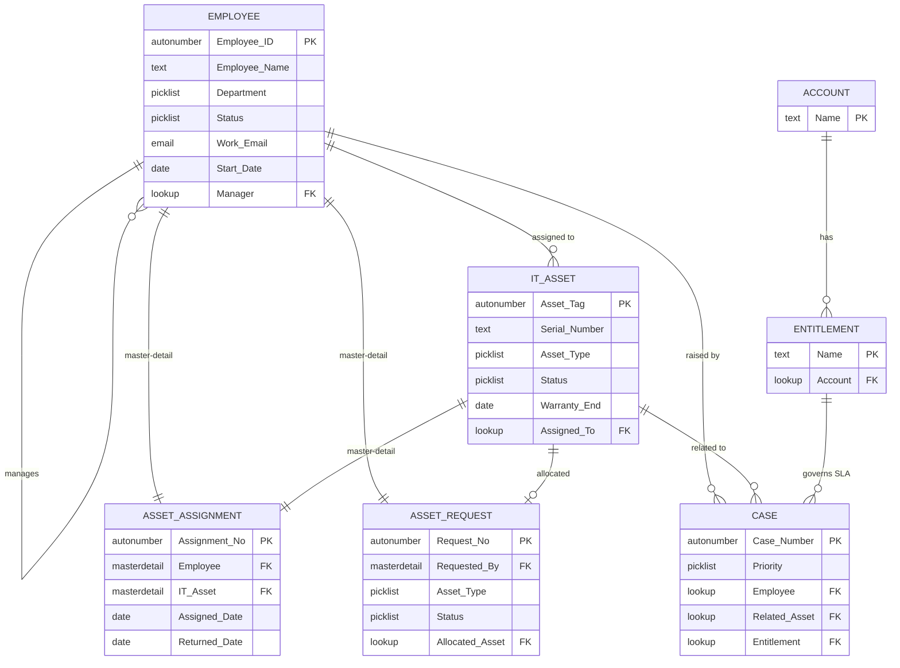

# Enterprise HRM, Asset & Case Management

A Salesforce Developer Edition project built to practise Salesforce administration: data model, security, Service Cloud, Flow automation, reports and dashboards, and data quality.

## Project status
- [ ] Phase 1: Data model
- [ ] Phase 2: Security
- [ ] Phase 3: Service Cloud
- [ ] Phase 4: Automation
- [ ] Phase 5: Reports and dashboards
- [ ] Phase 6: Data quality
- [ ] Phase 7: Lightning app and UI
- [ ] Phase 8: Documentation and demo video

## Folders
- docs: screenshots, data model diagram, security matrix
- data: dummy CSV files used with Data Loader

## Built by
Kavish Muthusamy Karthi, Salesforce Certified Administrator

## Architecture Diagram





### Complete Combined Phase 1 Section (Ready to Paste):

```markdown
## 🛠️ Step-by-Step Data Model & Schema Implementation

### Phase 1: Custom Objects, Fields & Schema Configuration

#### 1. Update Existing Objects
* **Employee (`Employee__c`):**
  * Navigate to **Setup > Object Manager > Employee > Fields & Relationships**.
  * Locate `Direct Reports`, click **Edit**.
  * Change **Field Label** to `Manager` and **Field Name** to `Manager`. Click **Save**.

---

#### 2. Create `IT Asset` Custom Object
* **Object Setup:**
  * **Label:** `IT Asset` | **Plural Label:** `IT Assets` *(Check: Starts with vowel sound)*
  * **Record Name:** `Asset Tag` | **Data Type:** `Auto Number`
  * **Display Format:** `AST-{0000}` | **Starting Number:** `1`
  * **Optional Features:** Check *Allow Reports*, *Allow Activities*, and *Track Field History*.
  * **Deployment Status:** `Deployed`
  * **Tab:** Launch New Custom Tab Wizard on Save.

* **Fields & Relationships:**

| Field Label | API Name | Data Type | Configuration / Picklist Values |
| :--- | :--- | :--- | :--- |
| **Serial Number** | `Serial_Number__c` | Text (50) | Required, Unique, External ID |
| **Asset Type** | `Asset_Type__c` | Picklist | `Laptop`, `Desktop`, `Monitor`, `Mobile`, `Accessories` |
| **Status** | `Status__c` | Picklist | `Available` (Default), `Allocated`, `Under Repair`, `Retired` |
| **Purchase Date** | `Purchase_Date__c` | Date | — |
| **Warranty End** | `Warranty_End__c` | Date | — |
| **Assigned To** | `Assigned_To__c` | Lookup | Lookup to `Employee__c` |

---

#### 3. Create `Asset Request` Custom Object
* **Object Setup:**
  * **Label:** `Asset Request` | **Plural Label:** `Asset Requests`
  * **Record Name:** `Request No` | **Data Type:** `Auto Number`
  * **Display Format:** `REQ-{0000}` | **Starting Number:** `1`
  * **Tab:** Create Custom Tab on Save.

* **Fields & Relationships:**

| Field Label | API Name | Data Type | Configuration / Picklist Values |
| :--- | :--- | :--- | :--- |
| **Requested By** | `Requested_By__c` | Master-Detail | Primary Master-Detail to `Employee__c` |
| **Asset Type** | `Asset_Type__c` | Picklist | `Laptop`, `Desktop`, `Monitor`, `Mobile`, `Accessories` |
| **Justification** | `Justification__c` | Text Area | — |
| **Priority** | `Priority__c` | Picklist | `Low`, `Medium` (Default), `High` |
| **Status** | `Status__c` | Picklist | `Draft` (Default), `Submitted`, `Approved`, `Rejected`, `Fulfilled` |
| **Estimated Cost** | `Estimated_Cost__c` | Currency | — |
| **Allocated Asset** | `Allocated_Asset__c` | Lookup | Lookup to `IT_Asset__c` |

---

#### 4. Create `Asset Assignment` Junction Object
* **Object Setup:**
  * **Label:** `Asset Assignment` | **Plural Label:** `Asset Assignments`
  * **Record Name:** `Assignment No` | **Data Type:** `Auto Number`
  * **Display Format:** `ASG-{0000}` | **Starting Number:** `1`

* **Fields & Relationships:**

| Field Label | API Name | Data Type | Configuration / Picklist Values |
| :--- | :--- | :--- | :--- |
| **Employee** | `Employee__c` | Master-Detail | Master-Detail to `Employee__c` (Primary) |
| **IT Asset** | `IT_Asset__c` | Master-Detail | Master-Detail to `IT_Asset__c` (Secondary) |
| **Assigned Date** | `Assigned_Date__c` | Date | — |
| **Returned Date** | `Returned_Date__c` | Date | — |
| **Condition** | `Condition__c` | Picklist | `Good`, `Fair`, `Damaged` |

---

#### 5. Roll-Up Summary on `Employee`
* Navigate to **Setup > Object Manager > Employee > Fields & Relationships > New**.
* **Type:** Roll-Up Summary
* **Field Label:** `Assets Assigned` (`Assets_Assigned__c`)
* **Summarized Object:** `Asset Assignment`
* **Roll-Up Type:** `COUNT`
* **Filter Criteria:** Only records meeting criteria: `Returned Date` `equals` `null` *(Counts active assigned assets)*

---

#### 6. Extend Standard `Case` Object
* Navigate to **Setup > Object Manager > Case > Fields & Relationships > New**.

| Field Label | API Name | Data Type | Configuration |
| :--- | :--- | :--- | :--- |
| **Employee** | `Employee__c` | Lookup | Lookup Relationship to `Employee__c` |
| **Related Asset** | `Related_Asset__c` | Lookup | Lookup Relationship to `IT_Asset__c` |

---

#### 7. Add Data Validation Logic
* Navigate to **Setup > Object Manager > IT Asset > Validation Rules > New**.

* **Rule Setup:**
  * **Rule Name:** `Warranty_After_Purchase`
  * **Active:** `Checked`
* **Formula:**
  ```sql
  AND(
      NOT(ISBLANK(Purchase_Date__c)),
      NOT(ISBLANK(Warranty_End__c)),
      Warranty_End__c < Purchase_Date__c
  )
