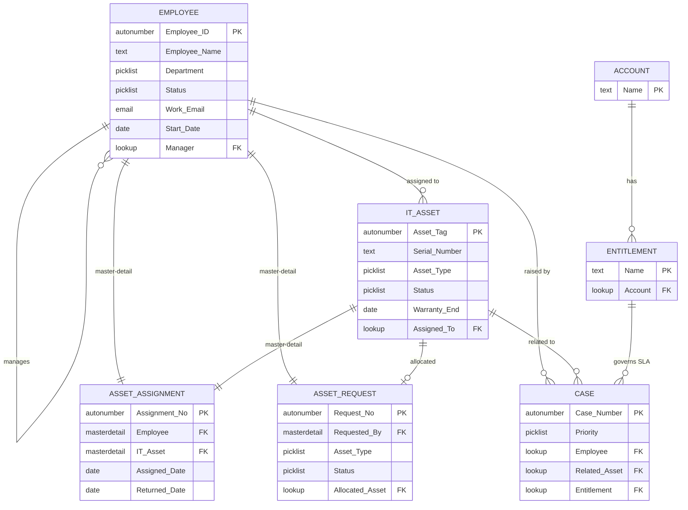

# Enterprise HRM, Asset & Case Management

A Salesforce Developer Edition project built to practise Salesforce administration: data model, security, Service Cloud, Flow automation, reports and dashboards, and data quality.

## Project status
- [ ] Phase 1: Data model
- [ ] Phase 2: Security
- [ ] Phase 3: Service Cloud
- [ ] Phase 4: Automation
- [ ] Phase 5: Reports and dashboards
- [ ] Phase 6: Data quality
- [ ] Phase 7: Lightning app and UI
- [ ] Phase 8: Documentation and demo video

## Folders
- docs: screenshots, data model diagram, security matrix
- data: dummy CSV files used with Data Loader

## Built by
Kavish Muthusamy Karthi, Salesforce Certified Administrator

## Architecture Diagram

# Progress
1
Fix the Manager field
If you haven't yet: Object Manager, Employee, Fields and Relationships, click Direct Reports, Edit. Change Field Label to Manager and Field Name to Manager. Save.
2
Create the IT Asset object and its fields
Object Manager, Create, Custom Object. Label: IT Asset. Plural: IT Assets. Tick Starts with vowel sound. Record Name: change the label to Asset Tag, Data Type Auto Number, Display Format AST-{0000}, Starting Number 1. Tick Allow Reports, Allow Activities and Track Field History. Deployment Status Deployed. Tick Launch New Custom Tab Wizard and Save. Then add these fields (Fields and Relationships, New): Serial Number (Text 50, tick Required, Unique and External ID); Asset Type (Picklist: Laptop, Desktop, Monitor, Mobile, Accessories); Status (Picklist: Available, Allocated, Under Repair, Retired, with the first value as default); Purchase Date (Date); Warranty End (Date); Assigned To (Lookup to Employee).
3
Create the Asset Request object and its fields
Create a custom object in the same way. Label: Asset Request. Record Name label: Request No, Data Type Auto Number, Display Format REQ-{0000}. Same options and tab wizard. Then add fields: Requested By (Master-Detail Relationship to Employee, the first field you create); Asset Type (Picklist with the same five values); Justification (Text Area); Priority (Picklist: Low, Medium, High, with Medium as default); Status (Picklist: Draft, Submitted, Approved, Rejected, Fulfilled, with Draft as default); Estimated Cost (Currency); Allocated Asset (Lookup to IT Asset).
4
Create the Asset Assignment junction object
Create a custom object. Label: Asset Assignment. Record Name label: Assignment No, Auto Number, Display Format ASG-{0000}. Add the first Master-Detail field: Employee (Master-Detail Relationship to Employee). Then add a second Master-Detail field: IT Asset (Master-Detail Relationship to IT Asset). The first one becomes the primary master. Then add Assigned Date (Date), Returned Date (Date) and Condition (Picklist: Good, Fair, Damaged).
5
Add the roll-up summary on Employee
Object Manager, Employee, Fields and Relationships, New. Choose Roll-Up Summary. Field Label: Assets Assigned. Summarized Object: Asset Assignment. Roll-Up Type: COUNT. Filter Criteria: Only records meeting certain criteria, then Returned Date, equals, and leave the value empty. Save. This counts only assets that have not been returned.
6
Add two lookups on Case
Object Manager, Case, Fields and Relationships, New. Create a Lookup to Employee with Field Label Employee. Create another Lookup to IT Asset with Field Label Related Asset. Click Next and Save each time.
7
Add one validation rule
Object Manager, IT Asset, Validation Rules, New. Rule Name: Warranty_After_Purchase. Formula: AND(NOT(ISBLANK(Purchase_Date__c)), NOT(ISBLANK(Warranty_End__c)), Warranty_End__c < Purchase_Date__c). Error Message: Warranty End cannot be before Purchase Date. Error Location: Field, and choose Warranty End. Save.
8
Screenshots, upload and tick Phase 1
Take a screenshot of each object's Fields and Relationships list (Employee, IT Asset, Asset Request, Asset Assignment) and name them clearly, for example phase1-it-asset-fields.png. Upload them to the Images folder on GitHub with Add file, Upload files. In README, change - [ ] Phase 1 to - [x] Phase 1. Then send me the IT Asset and Asset Assignment screenshots.
