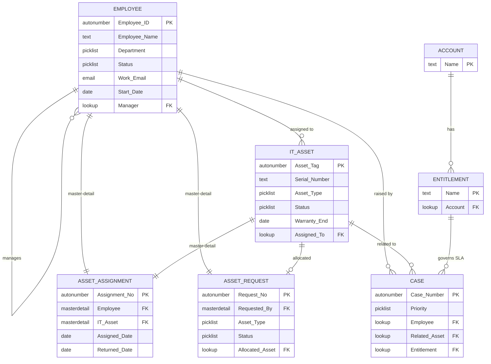

# Enterprise HRM, Asset & Case Management

A Salesforce Developer Edition project built to practise Salesforce administration: data model, security, Service Cloud, Flow automation, reports and dashboards, and data quality.

## Project status
- [ ] Phase 1: Data model
- [ ] Phase 2: Security
- [ ] Phase 3: Service Cloud
- [ ] Phase 4: Automation
- [ ] Phase 5: Reports and dashboards
- [ ] Phase 6: Data quality
- [ ] Phase 7: Lightning app and UI
- [ ] Phase 8: Documentation and demo video

## Folders
- docs: screenshots, data model diagram, security matrix
- data: dummy CSV files used with Data Loader

## Built by
Kavish Muthusamy Karthi, Salesforce Certified Administrator

## Architecture Diagram

